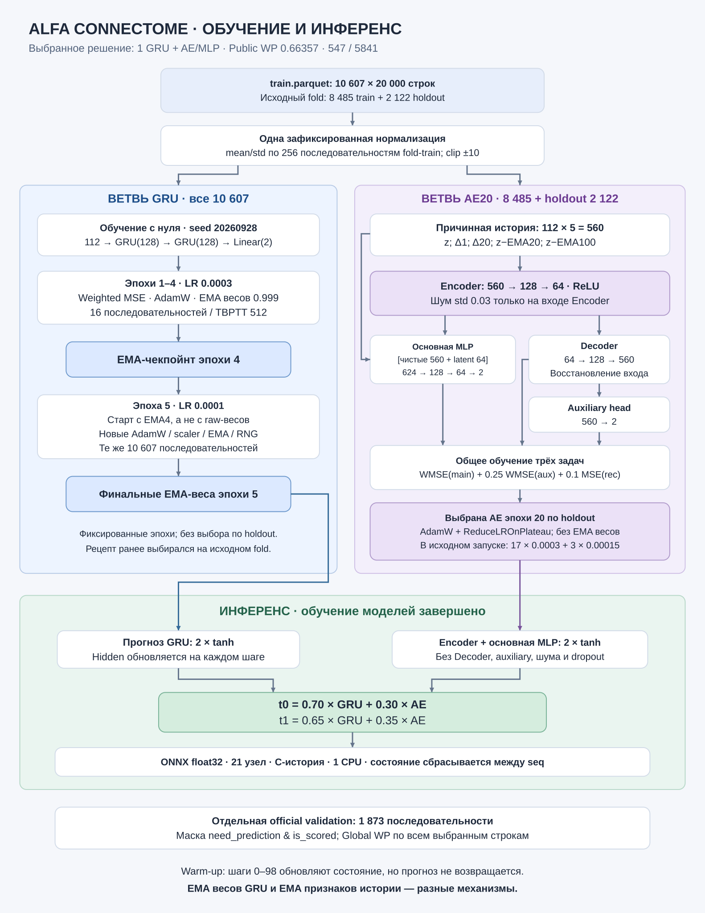

# Alfa Connectome — GRU + supervised autoencoder

Решение соревнования Wunder Fund / Alfa Connectome: потоковый прогноз двух
показателей будущего движения цены по 112 признакам стакана и сделок.

**Итоговое место: 646 из 5 800**.
Лучший результат публичного submission: **0.65490 Global WP**.
Время этого submission на сервере: **54 мин 41 с**, память **627 MB**.

## Что находится в проекте

| Путь | Содержимое |
|---|---|
| `artifacts/best_065490.zip` | Неизменённый архив, отправленный на сервер |
| `submission/` | Все семь файлов из архива: callback, ONNX, нормализация, C и бинарные библиотеки |
| `weights/` | Точные веса выбранных GRU и AE20 в формате PyTorch, включая decoder и auxiliary head AE |
| `src/` | Обучение, архитектуры, признаки истории, метрика, EMA и исправление запуска CUDA на Windows |
| `pipeline.py` | Переносимые команды проверки и обучения выбранного рецепта |
| `export_model.py` | Экспорт новых весов в проверенную топологию ONNX |
| `validate.py` | Проверка прогнозов/состояний, скорость на одном CPU, официальная валидация |
| `build_native.py` | Сборка C-модуля истории для Windows/Linux x86-64 |
| `package_submission.py` | Сборка нового ZIP без перезаписи исходного |
| `configs/`, `sequence_folds.json` | Зафиксированные рецепты, порядок разбиения и нормализация |
| `docs/` | Схема обучения и пояснения |
| `reports/` | Результаты, происхождение весов, история AE и проверки переносимости |

## Схема



Также доступны [PNG](docs/training_flow.png), [Mermaid](docs/training_flow.mmd)
и [описание архитектуры](docs/architecture.md).
Для пересборки SVG/PNG: `python -m pip install -r requirements-docs.txt`,
затем `python docs/render_diagram.py`.

## Архитектура

Это ансамбль **двух** прогнозов. MLP — прогнозирующая голова ветви AE.

- **GRU:** 112 нормализованных входов → 2 слоя GRU по 128 → Linear(128, 2) → `2*tanh`.
- **AE + MLP:** 560 причинных признаков → Encoder 560→128→64;
  конкатенация исходных 560 признаков и latent 64 → MLP 624→128→64→2 → `2*tanh`.
- Decoder 64→128→560 и вспомогательная голова 560→2 используются только при обучении.
- Смешивание: `t0 = 0.70*GRU + 0.30*AE`; `t1 = 0.65*GRU + 0.35*AE`.

Признаки истории: нормализованный текущий вектор, разности на лагах 1 и 20,
отклонения от EMA со span 20 и 100. Каждый блок имеет 112 компонент.
История вычисляется только по текущим и предыдущим строкам той же последовательности.

## Обучение выбранного решения

Общие параметры: seed **20260928**, AdamW, weight decay **0.0001**,
clip gradient norm **1**, сохранённая нормализация по **256** последовательностям
исходной обучающей части fold 0. Нормализация не пересчитывается на full-data.

| | Финальная GRU | AE20 |
|---|---|---|
| Обучающие последовательности | Все 10 607 из `train.parquet` | 8 485 из fold 0 |
| Holdout для этой стадии | Нет: фиксированный рецепт | 2 122 из того же `train.parquet` |
| Эпохи | 4 + 1 | До 20, выбран checkpoint эпохи 20 |
| LR | 4 эпохи 0.0003; затем 1 эпоха 0.0001 | Plateau: исходно 0.0003, в исходном запуске эпохи 18–20 на 0.00015 |
| Батч | 16 последовательностей; TBPTT 512 | 8 последовательностей × 512 выбранных строк |
| EMA весов | 0.999 | Нет |
| Loss | Weighted MSE | Main WMSE + 0.25 auxiliary WMSE + 0.1 reconstruction MSE |
| Регуляризация | GRU dropout 0.1 | Encoder input noise 0.03; MLP dropout 0.1 |

AE выбиралась на внутреннем holdout; `ReduceLROnPlateau` использовал его WP
(patience 2, factor 0.5, min LR 0.000003), early stopping patience 4.

## Установка

Python **3.11**, x86-64 Windows или Linux. Для полноценного обучения практически
нужен CUDA GPU; инференс работает на CPU. Проверенное окружение записано в
`reports/tested_environment.json` (PyTorch 2.11.0+cu128).

```powershell
python -m venv .venv
.\.venv\Scripts\Activate.ps1
python -m pip install torch==2.11.0 --index-url https://download.pytorch.org/whl/cu128
python -m pip install -r requirements.txt
python pipeline.py check
```

Для CPU-инференса без обучения достаточно `requirements-inference.txt`.
Проверки с parquet дополнительно используют PyArrow; сравнение с PyTorch — полный набор зависимостей.
В существующем совместимом окружении создавать ещё одно окружение не требуется.

## Быстрая проверка готового решения

```powershell
python pipeline.py check
python -m unittest discover -s tests -v
python validate.py verify
python validate.py benchmark
```

Без `--data` используются синтетические последовательности. Для проверки на реальных данных:

```powershell
python validate.py verify --data datasets/valid.parquet --groups 0 936 1872 --report runs/parity.json
python validate.py benchmark --data datasets/valid.parquet --groups 0 936 1872 --report runs/speed.json
```

Скрипт сравнивает C и NumPy preprocessing **побитово**: прогнозы, скрытые состояния,
history и EMA, включая warm-up и смену последовательностей. С PyTorch сравнение
выполняется с допуском `atol=rtol=1e-5`. Прогнозы до шага 99 не возвращаются,
но все строки обновляют состояние. Benchmark закрепляет процесс за одним
доступным логическим CPU и использует один поток ONNX Runtime.

Полное пошаговое оценивание занимает существенно больше времени:

```powershell
python validate.py evaluate --data datasets/valid.parquet --report runs/official_validation.json
```

Метрика — среднее двух **глобальных** Weighted Pearson, с clipping `[-2,2]`,
весом `abs(target)` и маской `need_prediction & is_scored`.
Она не усредняется по батчам или последовательностям. Исторический результат
ансамбля на official validation: **0.6828520974**, **3 528 273** оцениваемые строки.

## Переобучение с нуля

Получите данные у организаторов и положите `train.parquet` и `valid.parquet`
в `datasets/`. Можно задать существующий файл через `--train` для GRU;
для AE ожидается `datasets/train.parquet` внутри проекта.

```powershell
# Все 4+1 эпох; контрольные точки сохраняются в runs/gru_full.
python pipeline.py train-gru

# Независимая ветвь AE20; запускается с исходным fold и frozen normalization.
python pipeline.py train-ae
```

GRU также можно запускать по стадиям:

```powershell
python pipeline.py train-gru --stage base
python pipeline.py train-gru --stage finetune
```

## Экспорт и архив

Экспорт прилагаемых весов (без обучения):

```powershell
python export_model.py --output runs/export
python validate.py verify --source runs/export
python package_submission.py --source runs/export --output runs/rebuilt_submission.zip
```

Экспорт заново обученных моделей:

```powershell
python export_model.py --gru runs/gru_full/finetune1/epoch_05.pt --ae runs/ae20/best.pt --output runs/retrained
python validate.py verify --source runs/retrained --gru runs/gru_full/finetune1/epoch_05.pt --ae runs/ae20/best.pt --data datasets/valid.parquet
python validate.py benchmark --source runs/retrained --data datasets/valid.parquet
python package_submission.py --source runs/retrained --output runs/retrained_submission.zip
```

Экспорт сохраняет проверенную топологию из 21 ONNX-узла и заменяет **все**
18 параметрических initializer-тензоров инференса, включая веса обеих ветвей.
Decoder и auxiliary head в ONNX не попадают. Две операции GRU — два слоя одной
GRU. При экспорте прилагаемых весов ONNX совпадает
с исходным побайтово. Перепакованный ZIP может иметь другой hash из-за метаданных
архива; оригинал хранится отдельно в `artifacts/`.

Для сборки C-библиотек исходным компилятором:

```powershell
python build_native.py --zig "PATH/TO/zig-0.13.0/zig.exe" --output runs/native
```

Обе готовые библиотеки уже включены. Инференс на macOS/ARM этой версией не поддерживается.

## Воспроизводимость и происхождение

- Исходный ZIP: SHA256 `0180f2b526a09df9c7f74638abda455090a7e1efe4eafbbe8438f8b98b37ca51`.
- `MANIFEST.json` проверяет целостность опубликованного пакета.
- Веса сохранены без optimizer/RNG и абсолютных пользовательских путей;
  все модельные тензоры, включая обучающие части AE, сохранены точно.
- Повторное GPU-обучение с тем же seed не гарантирует побитовые веса на другом
  оборудовании/версиях библиотек. Исходный код использует `cudnn.benchmark=True`.
- При подготовке проекта выполнены unit tests, реальные проверки инференса и
  короткий тест обучения. Полное многoчасовое обучение и полная validation заново не запускались.
- Подробности — [архитектура](docs/architecture.md), [эксперименты](docs/experiments.md),
  [происхождение](NOTICE.md), машинные отчёты в `reports/`.
